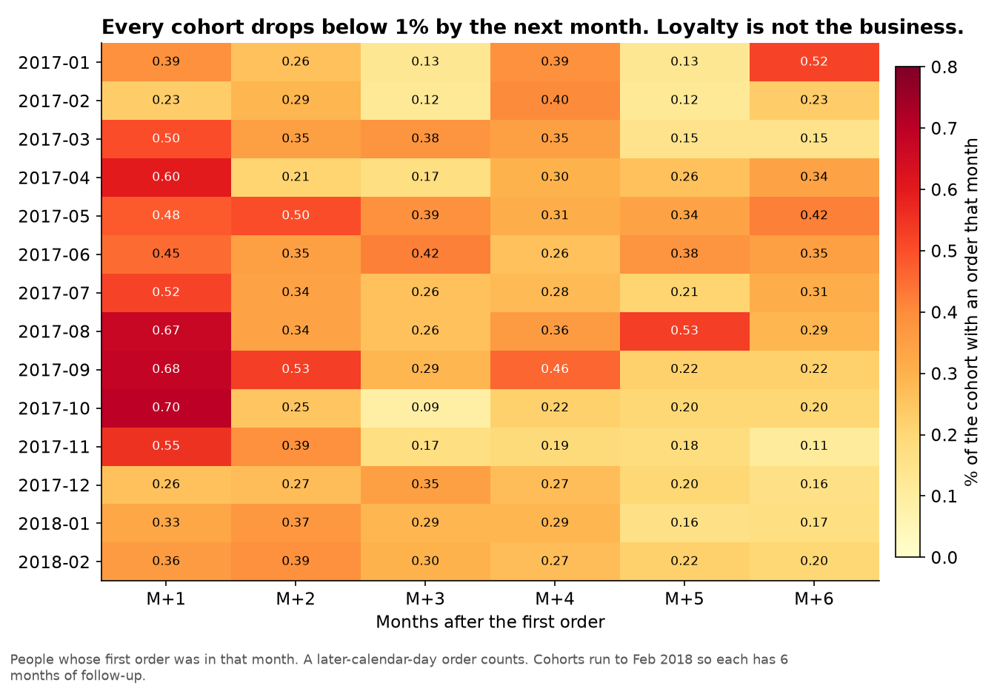
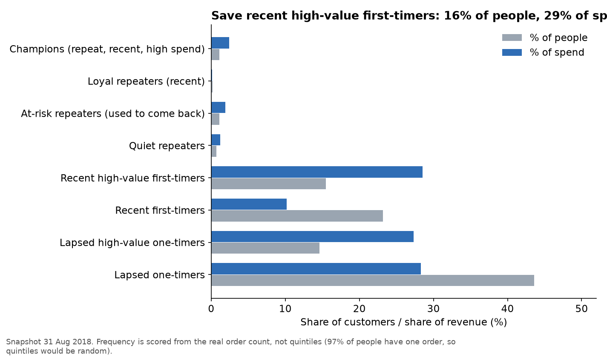

# Cohorts and RFM: which segment is worth saving first?

Window: Jan 2017 to Aug 2018. Snapshot for RFM: 31 Aug 2018. Code: `sql/04_star.sql`, `sql/04_cohorts_rfm.sql`.

## Cohort retention

Every first-order month behaves the same: **100% in month 0, then under 1% from month 1 onwards** (average 0.48% in month 1, 0.26% in month 6). There is no "good" cohort. Black Friday (Nov 2017) is the largest cohort and no more loyal than the rest.

**So what:** a retention programme, a win-back campaign, or a "loyalty" RFM playbook is the wrong product for this marketplace. The business lives on first orders.

## RFM segments
Frequency is **not** scored with quintiles. 96.9% of people have one order, so a 1-to-5 split on frequency would put identical one-timers into different buckets at random. Frequency is scored from the real count (1 / 2 / 3+). Recency and monetary still use quintiles.

| Segment | People | % people | % spend | Avg recency | Avg spend (BRL) |
|---|---:|---:|---:|---:|---:|
| 1 Champions | 1,013 | 1.1 | 2.4 | 91 days | 372 |
| 2 Loyal repeaters | 235 | 0.2 | 0.1 | 93 days | 96 |
| 3 At-risk repeaters | 1,034 | 1.1 | 1.9 | 384 days | 291 |
| 4 Quiet repeaters | 629 | 0.7 | 1.2 | 220 days | 304 |
| **5 Recent high-value first-timers** | **14,780** | **15.5** | **28.5** | **94 days** | **302** |
| 6 Recent first-timers | 22,080 | 23.2 | 10.2 | 92 days | 73 |
| 7 Lapsed high-value one-timers | 13,923 | 14.6 | 27.3 | 395 days | 308 |
| 8 Lapsed one-timers | 41,576 | 43.6 | 28.3 | 319 days | 107 |

## The one segment worth saving first
**Recent high-value first-timers (segment 5).** They are 16% of customers and 29% of revenue. They bought in the last ~90 days and spent about twice the typical first order. Their next review is still in play. The operational actions from the EDA apply directly to them: do not miss the delivery promise, and watch office-furniture and similar categories even when on time.

**What not to do**
- Do not spend the marketing budget winning back segment 8 (44% of people, cheap first orders, 2% chance of a second order).
- Do not build a VIP club around Champions (1% of people).
- Segment 7 (lapsed high-value one-timers) looks tempting on spend, but they last bought a year ago. A win-back test can wait; it is not the first action.

## Caveat
RFM here describes **one marketplace's** customers. A customer who also buys from other sellers on other platforms is invisible. That is a limit of the data, not of the method.
