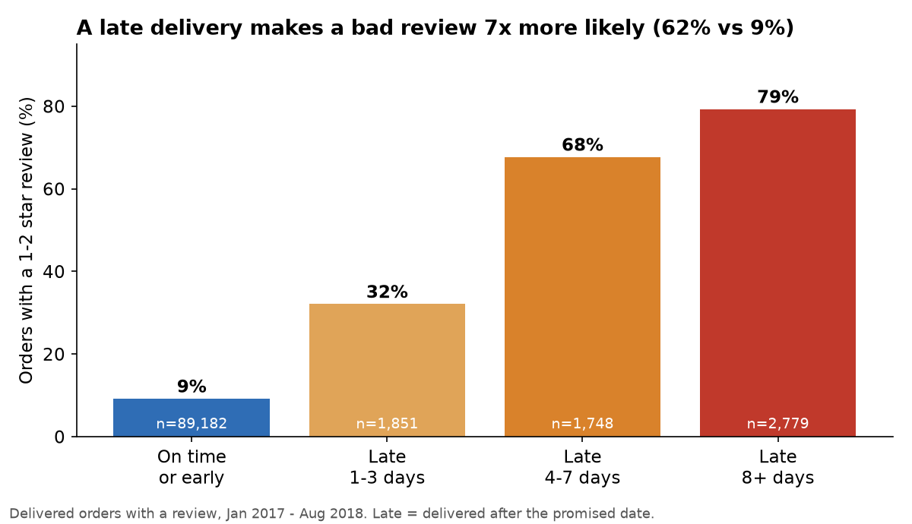
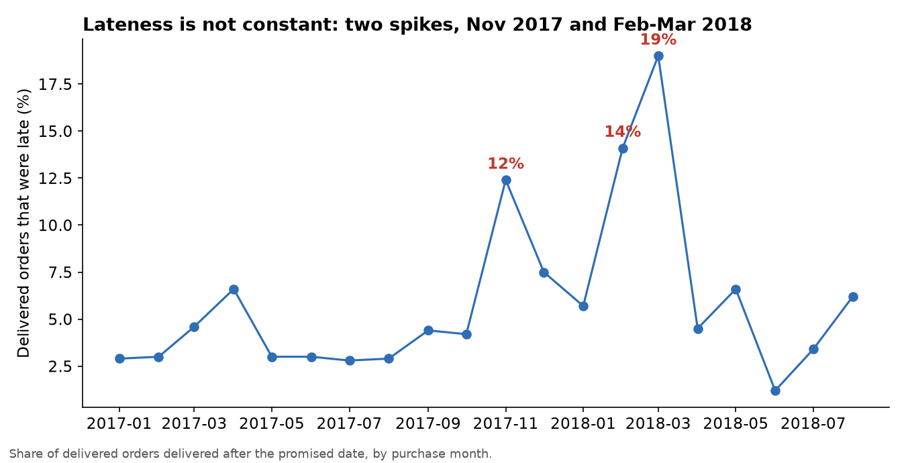
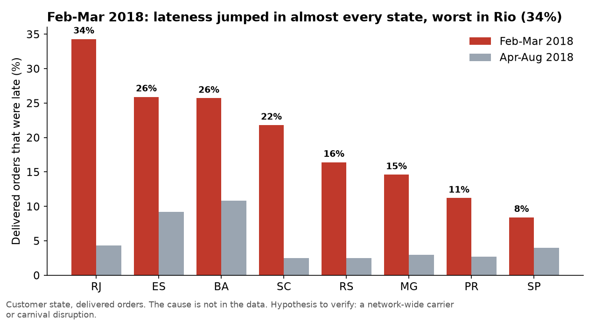
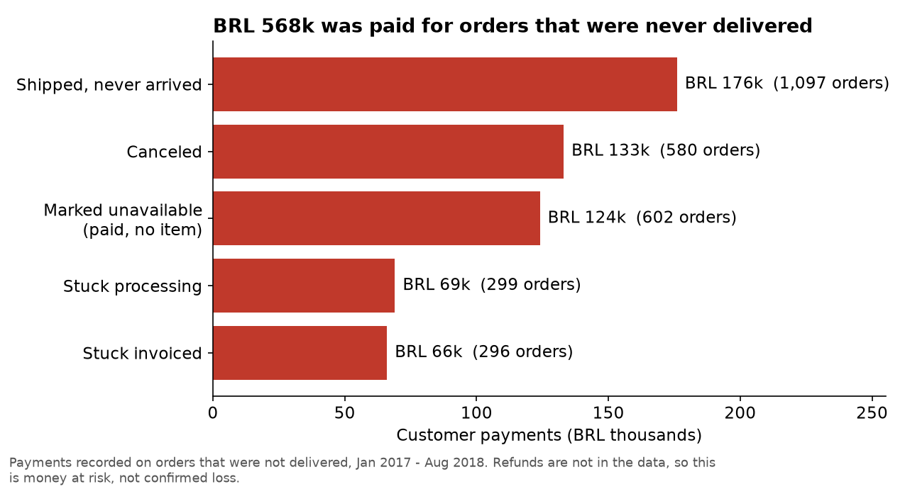
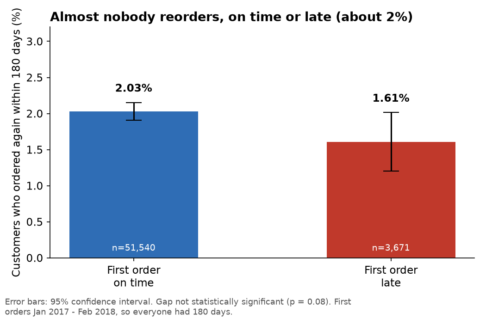
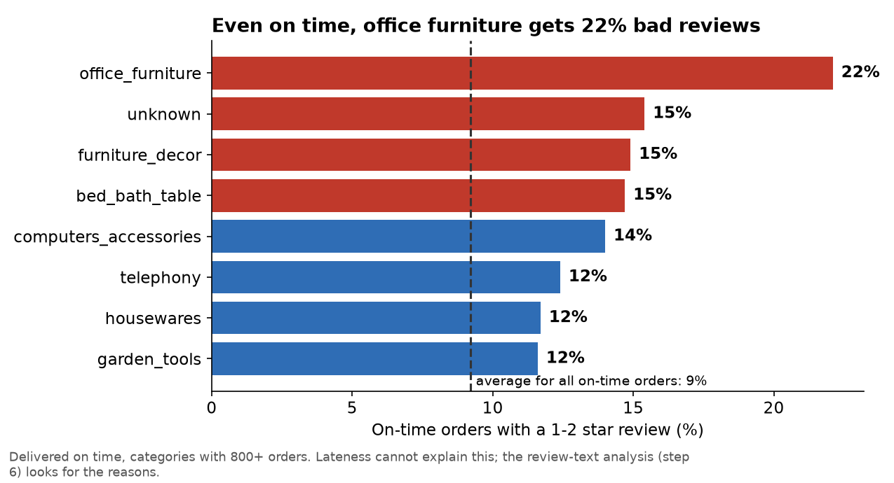

# EDA findings: what the data says, and what it means

Window: Jan 2017 to Aug 2018. Customers are people (`customer_unique_id`). Money is in Brazilian reais (BRL), order value = items + freight.
Code: `python/03a` to `03d`. Charts: `assets/eda/`.

## The five findings

### 1. Late delivery is the biggest controllable cause of bad reviews

- 9% of on-time orders get a 1-2 star review, against **62% of late orders** (79% when 8+ days late).
- Late orders are only 6.7% of delivered orders but produce **a third (33%) of all bad reviews** (3,981 of 12,228).
- **So what:** if late orders had the review rate of on-time orders, bad reviews would fall by about 3,400, or **28%**. Delivery promises matter more than almost anything else the team controls.

### 2. Lateness comes in waves, not as a steady problem

- Late rate sits around 3-6% most months, then jumps to **12% in Nov 2017** (Black Friday volume) and **14% in Feb and 19% in Mar 2018**.
- The Feb-Mar 2018 jump hit **almost every state** (Rio 34%, Espirito Santo 26%, Bahia 26%, Santa Catarina 22%, even Sao Paulo doubled to 8%), and order volume was normal, so it was not a volume problem.
- **So what:** the fix is an early-warning alert on weekly late rate by state, not a seller crackdown. The cause is not in the data; it needs a conversation with the carriers (hypothesis to verify: a network-wide disruption).

### 3. A few "bad sellers" are NOT the main problem (a first impression I corrected)
- First look: 97 of 2,945 sellers cause half of all late orders. That looked like concentration.
- After adjusting for size (sellers with 50+ orders, late rate at least double the network average of 6.7%): only **31 sellers**, causing **8.7%** of late orders. The first impression was mostly seller size.
- **So what:** lateness is mostly systemic (carrier and region), so escalating individual sellers would fix less than 10% of it. Still worth doing for the 31 worst, as a cheap action.

### 4. Money is lost on orders that never arrive

- **BRL 568k** was paid for orders that were never delivered (3.6% of order value): 1,097 "shipped" orders that never arrived (median age 282 days, so almost certainly lost), 580 canceled, **602 marked "unavailable" after the customer paid (BRL 124k, no item in the order)**, and ~600 stuck in processing or invoiced.
- Refunds are not in the data, so this is money at risk, not confirmed loss.
- **So what:** a weekly "stuck order" report (shipped for more than 14 days, processing for more than 7) would catch these. The "unavailable after payment" group points at sellers selling stock they do not have.

### 5. The usual retention story is weak here (an honest negative result)

- Only **2.0%** of customers order again within 180 days (strict definition: a later calendar day, so split orders do not count).
- Late first order: 1.61% reorder, on time: 2.03%. The gap (0.42 points) is **not statistically significant** (95% CI -0.02 to +0.82, p = 0.076). A bad first review (1.71% vs 2.07%) is borderline (p = 0.048).
- Lost repeat revenue per late order is about BRL 0.7 (0.42 points x BRL 160 average order). Tiny.
- **So what:** do **not** pitch a loyalty programme. This marketplace lives on first orders, so the cost of a bad delivery is mainly reputation (reviews), not lost repeat orders. Caveat: customers may be buying elsewhere on the platform in ways this data cannot show.

## A sixth lead for the text analysis

Even on-time orders get 22% bad reviews in office furniture (average 9%). Lateness cannot explain it. The review text (step 6) will look for the reasons.

## Caveats
- Observational data: late orders differ from on-time orders in other ways (region, product, seller), so these are strong associations, not proven causes.
- Dates are 2016-2018 and Brazilian. Patterns in lateness and reviews are likely to transfer; the exact numbers will not.
- 58% of reviews have no text, so the text analysis describes only customers who chose to write.
