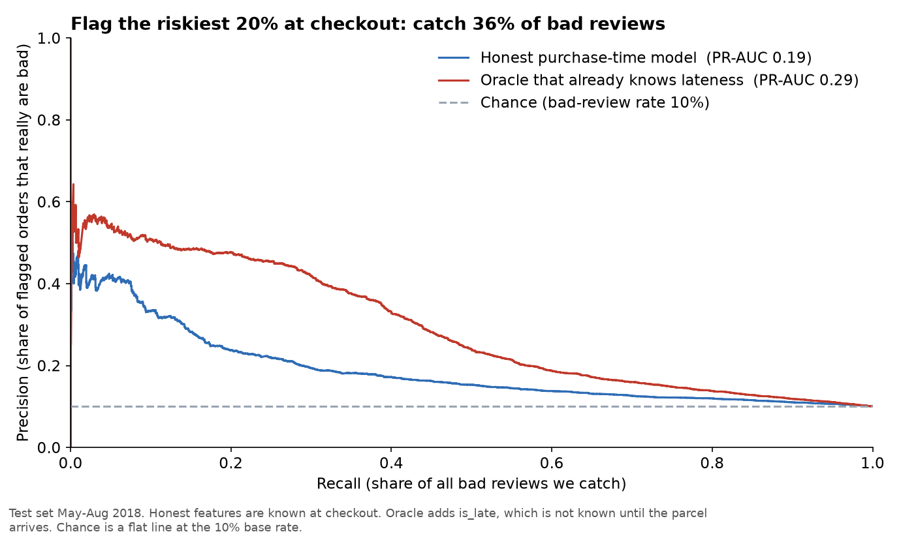
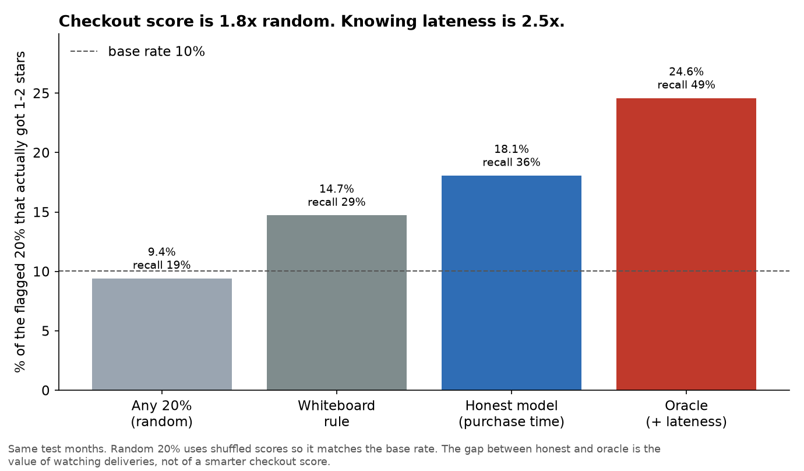
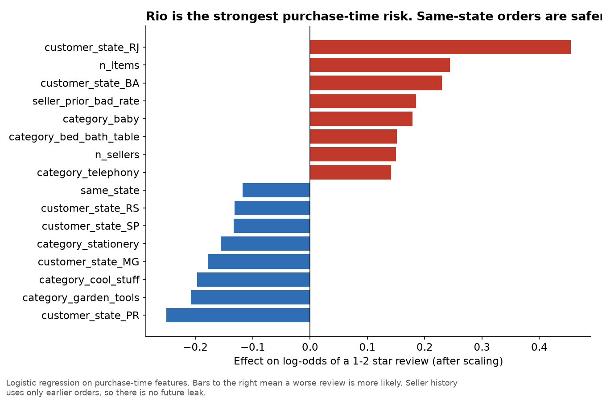

# Can we flag a bad review at purchase time?

Window: train Jan 2017–Apr 2018 (70,292 orders), test May–Aug 2018 (25,085 orders).
Target: 1–2 star review. Only delivered orders with a review are labelled.
Code: `sql/05_model_features.sql`, `python/05_predict_bad_review.py`.

## The rule I did not break
Nothing that happens after checkout goes into the honest model. No delivery date, no late flag, no review text. Seller history is a running rate from **earlier** orders only (the SQL window stops at 1 PRECEDING), so a seller's future failures cannot leak into today's score.

A second "oracle" model cheats by adding `is_late`. That is not a product. It is the ceiling: how well we could score reviews if we already knew the parcel would miss the promise.

## What the test months say

| Model | ROC-AUC | PR-AUC | Precision at top 20% | Recall at top 20% | Lift vs 10% base |
|---|---:|---:|---:|---:|---:|
| Random 20% | 0.50 | 0.10 | 9.4% | 19% | ~1.0x |
| Whiteboard rule (late history, tight promise, furniture, multi-seller) | 0.59 | 0.14 | 14.7% | 29% | 1.5x |
| **Honest logistic (purchase time)** | **0.64** | **0.19** | **18.1%** | **36%** | **1.8x** |
| Oracle (+ already knows lateness) | 0.72 | 0.29 | 24.6% | 49% | 2.5x |

If operations extra-cares the riskiest **20%** of orders, the honest model catches **36%** of the 1–2 star reviews and is right **18%** of the time (vs 10% by guessing). Useful, not magic.

## What the model is actually using

Strongest honest signals (standardised logistic coefficients):

- **Customer in Rio (RJ)** is the largest risk. Bahia next. This matches the EDA: Rio had the worst late rate in the 2018 spike.
- **More items / more sellers** on one order raise risk.
- **This seller's past bad-review rate** (before this order) raises risk. Past late rate helps too, but less.
- **Same-state delivery** and customers in SP / MG / PR are safer.
- A **longer promised window** is slightly safer (tight promises are harder to keep). Distance also adds a little risk.

Office furniture is only a weak extra signal once category is already in the model. The earlier EDA finding still matters for a specialist look at that category; it is not the main ranking feature.

## So what (the decision)
Do **not** pitch a "bad-review score at checkout" as the main product. The honest model is 1.8x random. The oracle that already knows lateness is 2.5x, and EDA already showed late orders get 62% 1–2 stars vs 9% on time.

**The value is in watching deliveries, not in a smarter checkout score.** Use the purchase-time score as a cheap extra: extra-care Rio / multi-item / historically-weak-seller orders, and keep the operational alert on weekly late rate by state (finding 2).

## Caveats
- Labels exist only for delivered orders with a review. Cancelled and never-reviewed orders are out of this model.
- Logistic regression, one time split. A tree model might pick up a few interactions; it will not close the gap to the oracle, because the missing variable is lateness itself.
- 2017–2018 Brazil. The *method* (no future leak, time split, oracle ceiling) travels. The exact lift will not.
