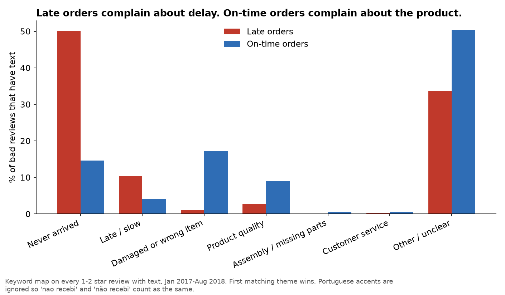
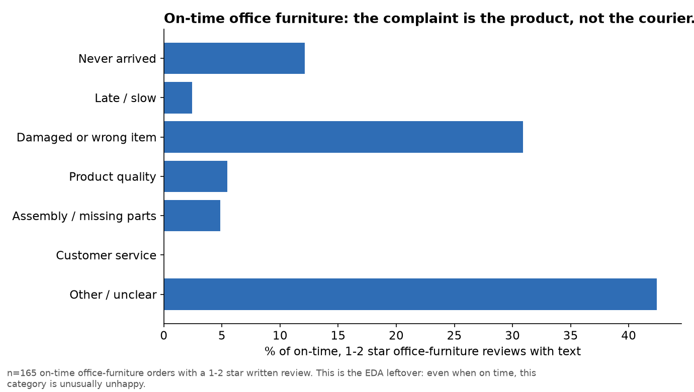

# What unhappy customers actually write

Window: Jan 2017–Aug 2018. 40,514 reviews have text (of which 10,737 are 1–2 stars).
Code: `python/06_review_themes.py`, `python/06b_handcheck.py`. Audit files: `docs/theme_sample.csv`, `docs/theme_handcheck.csv`.

Portuguese comments are classified into English theme codes. Accents are ignored so `nao recebi` and `não recebi` count as the same.

## Two methods, on purpose
1. **Keyword map on all 40,514 comments** — free, full coverage, blunt.
2. **Gemini on a 120-row stratified sample** — 8 API calls. Google returned HTTP 503 on half the batches, so **60 rows** got an LLM label. That is a quota/availability limit, not a modelling choice.
3. **A person read 40 of those 60** in Portuguese and assigned a theme without looking at the model first. That is the accuracy number.

## Accuracy (the number that makes the AI claim honest)
| Label source | Agreement with the person (n=40) |
|---|---|
| Keywords | 30% (12/40) |
| **Gemini** | **78% (31/40)** |

Gemini’s typical miss: it calls a missing-parts complaint `customer_service` because the customer also said “I emailed and nobody replied.” The product problem is the cause; the unanswered email is the follow-up. Keywords’ typical miss: `nao recebi` in “I have not received a **reply**” was tagged as never-arrived. That pattern was then tightened.

78% is good enough to trust the **direction** of the themes. It is not good enough to auto-reply to customers.

## The finding (keywords on every bad review with text)

| Theme | Late (n=2,745) | On time (n=6,449) |
|---|---:|---:|
| Never arrived | 50% | 15% |
| Late / slow | 10% | 4% |
| Damaged or wrong item | 1% | 17% |
| Product quality | 3% | 9% |
| Other / unclear | 34% | 50% |

**So what:** late orders complain about **logistics**. On-time orders complain about **the product**. The 15% of “on-time” reviews that still say “I never got it” is a second operations problem: the carrier marked delivered and the customer disagrees.

The 60 Gemini labels (smaller, cleaner) say the same thing in sharper numbers: late + bad → 80% delivery themes (`never_arrived` 47% + `late_or_slow` 33%). On-time + bad → 57% product themes (`damaged_or_wrong` 37% + `quality` 20%). All 15 five-star comments in the sample were labelled `praise` (and the person agreed).

## Office furniture, even when on time

165 on-time, 1–2 star furniture reviews with text: **31% damaged or wrong item**, 5% assembly, 12% never arrived. This is the leftover from the EDA chart. The courier is not the main story here — missing pieces, wrong colour, and flimsy product are.

## So what (the decision)
- Delivery ops: keep the weekly late-rate alert. The text confirms those 1–2 star reviews are about the parcel, not the catalogue.
- Seller quality: a second queue for on-time 1–2 star reviews, starting with office furniture (damaged / incomplete).
- Do not auto-close tickets with the LLM. 78% accuracy is a research label, not a customer-facing action.

## Caveats
- 58% of reviews have no text. Themes describe people who chose to write, who are more often unhappy.
- Gemini tagged 60 of 120 rows because of HTTP 503. The person-checked accuracy uses those 60.
- Observational: a late order can also be a bad product. The split is still large enough to act on.
